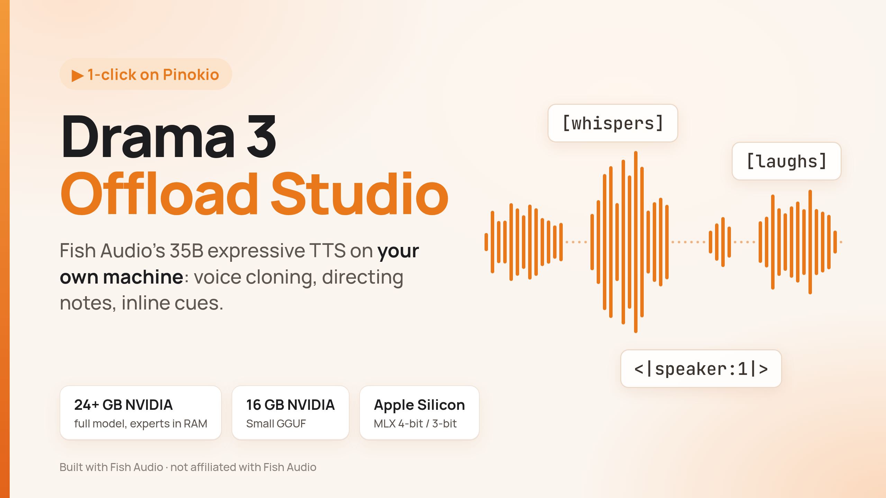

<p align="center">
  
</p>

# Drama 3 Offload Studio

Run [Fish Audio Drama 3](https://huggingface.co/fishaudio/drama-3) on your own computer, in the studio from Fish Audio's official [Drama-3 Space](https://huggingface.co/spaces/fishaudio/Drama-3), installed with one click in [Pinokio](https://pinokio.co).

Drama 3 is a 35B-parameter mixture-of-experts text-to-speech model (3B active per token) for expressive, multi-character speech in 80+ languages: clone a voice from a clip, design one from a description, and direct the performance with notes and inline cues such as `[sighs]` or `<whisper>…</whisper>`.

> [!NOTE]
> This is an unofficial, offline version, not endorsed nor created by Fish Audio. The model weights are under the [Fish Audio Community License](https://huggingface.co/fishaudio/drama-3/blob/main/LICENSE): free for research, non-commercial use, and commercial use while your annual revenue is under USD 500,000. Larger commercial use, and offering it as a hosted voice service, need a license from Fish Audio. Only clone voices you have permission to use.

## What this adds to the Space

The Space needs a ~45 GB GPU. This launcher runs the same Studio locally, with the model in the same process, and adds:

- **Runs on a 24-32 GB NVIDIA card.** The model's experts live in system RAM, with the most-used ones cached in VRAM ([expert offload](#expert-offload)).
- **A 16 GB option:** the [Small GGUF](#small-gguf-16-gb-vram) (drama3-small), and **Apple Silicon** through [MLX](#macos-mlx) (experimental).
- **No script length limit.** Long scripts are split into chunks that play as one take, each voiced knowing the next.
- **Edit by infilling.** Change a few words and only those words are regenerated; the audio around them is kept.
- **Quality Mode.** Every take is checked word by word with Whisper and remade if words are missing, and a cloned voice can be guided closer to its clip.
- **Fewer broken takes:** a [pause fix](#pause-fix) and a [stall guard](#stall-guard) for takes that go silent or drone, and [checks while streaming](#every-word-read-while-streaming) that catch skipped words and make the missing ones.
- **Clean chunk joins:** each chunk's trailing breath and hiss fade out under the start of the next, without fading a word.
- **Tags that work with clones.** [Tag guidance](#tag-guidance) makes a cloned voice follow `<whisper>` and other `<tags>`.
- **Fish Audio's direction set:** all the paired and language tags of their Drama 3 guide in the palette, words given as phonemes (IPA or Arpabet), and a [pronunciation dictionary](#directing) of alias and phoneme rules for every script.
- **Subtitles:** import an `.srt` as a timed script, or export the subtitles of any take.
- **Reference clips up to 60 s** instead of 20 s.
- **A JSON [API](#api)** for scripts and other apps.

## Install

1. In [Pinokio](https://pinokio.co), choose **Download from URL** and paste `https://github.com/ThomasEricB/drama3-offload-studio`.
2. Pick the **Install** entry for your hardware:

| Menu | Hardware | Model | Download |
| --- | --- | --- | --- |
| **Install (24+ GB VRAM)** | NVIDIA, 24 GB or more | The full Drama 3 (FP8), its experts in system RAM on 24-32 GB cards | 41 GB |
| **Install Small GGUF (16 GB VRAM)** | NVIDIA, 16 GB or more | [drama3-small](https://huggingface.co/pentacoxian-dev/drama3-small-GGUF): ~45% of the experts, ~3-bit, distilled on **Japanese and English** | 10 GB |
| **Install MLX 4-bit (Apple Silicon, 64 GB)** | Apple Silicon, 64 GB (48 GB with a raised limit) | The full model as [drama-3-MLX-4bit-HQ](https://huggingface.co/fcmeyer/drama-3-MLX-4bit-HQ); peaks at ~39 GB of unified memory | 26 GB |
| **Install MLX 3-bit (Apple Silicon, 48 GB)** | Apple Silicon, 48 GB | The full model as [drama-3-MLX-3bit-HQ](https://huggingface.co/fcmeyer/drama-3-MLX-3bit-HQ); peaks at ~34 GB | 21 GB |

3. Press the matching **Start** entry, then **Open Web UI**.

All the models share the app and its Python environment, so another one can be added at any time. **Update** pulls the launcher and re-checks only the models that are installed. **Reset** deletes `app/` (code and Python environment) but keeps the downloaded models, so a reinstall doesn't download them again; delete `models/` to reclaim the space.

Start loads the model on the CPU, moves it into place (about a minute), and opens the server. A warm-up take then compiles kernels in the background for about 30 s; a take started during it waits for it. On a Mac there is no warm-up.

## Using the Studio

### Voices

- **Surprise:** the model improvises a voice that fits the line, a different one every take.
- **Clone:** one of the three preset voices, or upload or record a clip. Whisper transcribes it, and you can edit the transcript. Clips are trimmed to 20 s; tick **Allow reference clips up to 60 s** to keep more.
- **Design:** cast a voice from a written description (character, voice description, optional scene).
- **Keep this voice** turns any take into a clone voice, so later lines keep it.

### Directing

| Write | Example | Effect |
| --- | --- | --- |
| Point cue | `Well [sighs] fine, you win. [laughs]` | An event at that point |
| Scoped tag | `Promise me <whisper>you won't tell her</whisper>.` | A delivery over a span: `whisper`, `emphasis`, `soft`, `fast`, `slow`, `stress`, `forceful` are the ones Fish Audio lists |
| Language tag (experimental) | `He said <japanese>ありがとうございました</japanese> and left.` | A phrase in another language: `french`, `spanish`, `german`, `italian`, `japanese`, `chinese`, `korean` |
| Phonemes | `I am an <\|phoneme_start\|>ˈɛndʒəˈnɪr<\|phoneme_end\|>.` | A word read as these phonemes: IPA in any language, or CMU Arpabet (`EH0 N JH AH0 N IH1 R`, the digit is the stress), pinyin, romaji |
| Style prefix | `[icy calm] Fine.` | The tone of the whole line |
| Director's note | `Direction: put the rise on "goodbye".` then `Line: So this is goodbye.` | Acting direction for the line |
| Language hint | `[language: fr]` | Names the line's main language |
| Duration hint | `[audio tokens: 65]` | Asks for about 3 s (about 21.5 per second) |

None of these are spoken. The script box highlights them, and the **Direction tags** palette under it inserts them: its Span and Language rows wrap the selected words, and **phonemes** wraps phonemes you typed. The tag lists, language tags and IPA are from Fish Audio's Drama 3 guide ([fishaudio/docs #239](https://github.com/fishaudio/docs/pull/239), [#292](https://github.com/fishaudio/docs/pull/292)). The Space refuses `<|…|>` tokens in a script; here the phoneme pair is let through, and every other one still is refused. A word given as phonemes is left out of the word checks (Whisper hears the word, the script only has its sounds) and of subtitles.

**Pronunciation dictionary** (under **How to direct**): rules applied to every script, the Studio's and the API's, as Fish Audio's pronunciation dictionaries ([fishaudio/docs #292](https://github.com/fishaudio/docs/pull/292)). A *phoneme* rule reads its input as the output's phonemes (`Siobhan` → `ʃɪˈvɔːn`); an *alias* rule reads the output instead (`km/h` → `kilometers per hour`, `k8s` → `Kubernetes`). As there: the first of duplicate inputs wins, the earliest match and then the longest input wins, matching ignores case unless *Case sensitive* is ticked, and replacements are not matched again. Here an input that starts or ends with a letter or digit matches whole words only, and `[directions]`, `<tags>` and a `Direction:` line are left alone. **Import .pls** adds a PLS lexicon's `<phoneme>` and `<alias>` entries; **Download .pls** saves the rules. They are kept in `cache/pronunciation.json`.

### Takes, notes and edits

- **Perform** streams the take as it is generated.
- **Give a note:** type a note (or pick one of the chips) and press **Retake**. The actor hears the take and redoes the line with your note.
- **Edit:** leave the note empty, change words in the script and press **Retake**. Only the changed words are regenerated ([edit by infilling](#long-scripts-and-edits)).
- **Take history:** click a take's box to select it without playing it, or **▶ Play** to hear it. Retake, edits, **Keep this voice**, **Download** and **Subtitles of this take** act on the selected take, and its line comes back into the script.

### Quality Mode

**Check every word before playing (Quality Mode)**, in its own box between Voice and Sampling, trades streaming for accuracy. Each take, and each chunk of a long script, is held until it is made and its whole transcript is compared with the line; below 90% it is made again (at most twice) and the best one plays.

Under it, **Voice guidance** (0-3, default 2) makes a cloned voice closer to its clip, at about 1.5x the time. It is greyed out while Quality Mode is off, as it only applies to takes that are not streamed. See [voice guidance](#voice-guidance) for what it does and what it costs.

In the **Experimental** card above it (the sampler is greyed out while the box is off), and in the Quality Mode box:

- **Enable Experimental Changes** (off by default) switches four sampler changes together, from the next take; off, every draw is the Space's own.
  - The main token (end of speech or a semantic code) is drawn with no top-p cut. In a drone the repeating code holds ~97% and end of speech ~3%, which top-p 0.9 cuts on every step ([torenyx/drama3-24gb](https://github.com/torenyx/drama3-24gb)).
  - A remake after a stall also loosens the repeat-avoiding redraw (same source).
  - The 9 acoustic codebooks draw from at most 30 candidates, and the redraw keeps the token that crosses top-p: SGLang Omni's fixes of 2026-10-20 ([#2810](https://github.com/sgl-project/sglang-omni/pull/2810), [#2890](https://github.com/sgl-project/sglang-omni/pull/2890)).
  - With Quality Mode on, a take with a phrase that jumps far above the voice's pitch is made once more (the register guard of [drama-tensorfold](https://github.com/plotarmordev/drama-tensorfold)).
  - Tested on pause-heavy lines (two cloned voices, 80 takes a side): 70 drones caught instead of 136, 61 takes right first time instead of 51, 17 still missing words after every retry instead of 26. A seed makes a different take with them on.
  - **Experimental sampler** picks how the main token is drawn while the box is on: *Community fixes* (the set above, the default) unless you pick another. *Fish reference sampling* is Fish Audio's own rule for Drama 3, from [sglang-omni #3278](https://github.com/sgl-project/sglang-omni/pull/3278) (also [vllm-omni #9503](https://github.com/vllm-project/vllm-omni/pull/9503)): the main token is drawn from every candidate of at least 0.1% probability (epsilon sampling), and a draw that repeats one of the last 16 main tokens, end of speech included, becomes the most probable candidate. *Fish reference sampling, RAS fallback* redraws it at temperature 1.0, top-p 0.95, top-k 30 instead. The other changes above apply to both: no top-p cut on the main token, the 30-candidate codebooks, the loosened redraw after a stall (which there replaces the most probable candidate, in a drone the drone itself) and the register guard. Tested against the fixes (Ramsay and Joker clones, 5 pause-heavy lines, one seed, Quality Mode, 10 pairs): 7 drones to 1, right first time 4 to 9, and preferred blind 3 to 5 (2 toss-ups). A repeated draw collapses to the most probable code, which in a pause or a held sound is the repeat itself.
- With the box on or off, the 9 residual codebooks never draw a code the codec lacks (it has 1024 per codebook, the heads score 4096; sglang-omni #3278). In testing 0.6% of their draws were past 1023, nearly all in the frame decoded after the end of speech, which is never heard; about one take in eight had one in its audio, always a take that had already gone wrong.
- **Length Hint** (off by default) adds Drama 3's `[audio tokens: N]` to every line, at 0.8 of the length the words need ([mlx-speech #49](https://github.com/appautomaton/mlx-speech/pull/49)). It steadies the pacing; blind, it was preferred on long takes.

### Long scripts and edits

The card under the stage holds the options for long scripts:

- **Long scripts.** A script longer than about 300 bytes is split into chunks at sentence ends, then clause marks, then spaces, never inside a `[cue]` or `<tag>…</tag>`. The chunks play as one take, and the counter under the script shows how many there are. Each chunk sees the first and the latest chunk as history (their text and audio), the layout fish-speech uses, so the voice stays the same; the next chunk starts a pause after the last word (0.45 s after a sentence, 0.25 s after a clause mark, 0.12 s otherwise). Line breaks inside the script are sent as spaces: with blank lines in its text Drama 3 could stop ending and draw silence instead (2 drones in 16 takes before, 0 after). Tested: a 1,034-character story played as 5 chunks, 51-80 s long, at 1.9-2.1x real time, with a 0.98-0.995 word match in Clone, Surprise and Design.
- **Read ahead across chunks** (on by default): each chunk is voiced knowing the next one, Drama 3's streaming-input format from the [technical report](https://github.com/fishaudio/fish-speech/blob/main/docs/assets/Fish_Audio_Drama_3_Technical_Report.pdf) (Figure 10). On a 5-chunk story (6 seeds per voice), a clone's pitch jump across a join fell from 3.35 to 2.29 semitones and the pitch spread between chunks from 1.28 to 0.92; Surprise voices did not change; words were unchanged (0.99) and takes about 6% brisker.
- **Crossfade chunk joins** (on by default): a chunk keeps full level 80 ms past its last word, then only its trailing breath and hiss fade out, and the next chunk starts at full level 0.35 s before that fade ends, so the fading hiss runs under its first words. No word is faded in or out. A chunk that ends right after its last word fades to silence and the pause is kept. Blind, over six joins: plain crossfades beat a trimmed end and a silent pause (which was picked worst in 4 of 6), and this speech-safe one beat a plain crossfade (best in 5 of 6).
- **Trim chunk tails** (on by default, used with crossfading off): each chunk is held 80 ms past its last word, faded out over 0.25 s and cut, before a silent pause.
- **Edit by infilling** (on by default): Drama 3's own editing method (report section 5.5, Figure 14).
  - Whisper's word timestamps locate the edit window, and the model fills it from a prompt holding the new text, a duration hint, and the audio after and before the window. The whole clip is decoded together, so the seams are smooth.
  - Whisper then checks that the new words are heard and the clip matches its script as well as before; otherwise it retries once, then regenerates the whole chunk.
  - Numbers are compared spelled out on both sides ("7" matches "seven", "$5" "five dollars", "21st" "twenty-first").
  - Tested on 16 edits x 2 voices (substitutions, insertions, deletions, at the start too): 14/16 infilled at the first attempt, word match 0.994; the other 2 failed on "7" vs "seven", which the spelled-out comparison now fixes. Works on single lines and inside long takes (a one-word insertion in a 5-chunk take: 11.5 s).
  - With it off, an empty-note Retake re-reads the edited script with the earlier takes as context.
- **Retake / Edit long takes (experimental**, off by default): retake or edit a take made of several chunks. With an empty note only the chunks whose words changed are regenerated, and the line under the box says which ones before you press Retake (a one-word edit in a 5-chunk take: 1 chunk in 7 s instead of 27). With a note, every chunk is redone, each guided by its old version.
- **Import subtitles (.srt)** turns an `.srt` file into a timed script, one cue per line, written `{00:01.200 --> 00:03.500} Text`. Each cue is voiced as its own chunk with a duration hint and placed at its start time; silences between cues are kept, and a cue that runs over pushes the next one back (cues at 0.5, 5.0 and 10.0 s started at 0.55, 5.05 and 10.05 s). Timed scripts can be edited cue by cue.
- **Subtitles of this take (.srt):** the selected take's script, timed by Whisper on its audio, one cue per sentence (at most 84 characters or 6 s).

### Workflow

The **Workflow** tab (also at `/workflow/`) is a `gr.Workflow` canvas that uses the same engine.

## Requirements

| | Linux | Windows | macOS |
| --- | --- | --- | --- |
| Hardware | NVIDIA RTX 40-series or newer | NVIDIA RTX 40-series or newer | Apple Silicon, **experimental** |
| Driver / OS | NVIDIA driver 580+ | NVIDIA driver 580+ | macOS 14+ |
| Memory | RAM for the offloaded experts (below) | RAM for the offloaded experts (below) | MLX 4-bit: 64 GB; MLX 3-bit: 48 GB; eager fallback: 64 GB minimum, 96 GB+ recommended |
| Status | Tested (RTX 5090, 32 GB) | Untested; dependencies verified to resolve | Untested on a Mac (see [MLX](#macos-mlx)) |

- **NVIDIA:** an RTX 40-series (Ada) or newer has the FP8 tensor cores the experts run on; older cards stop with a clear message. torch 2.13 is the CUDA 13 build, so the driver must be 580 or newer.
- **System RAM (full model):** 30 GiB of pinned RAM holds every expert. Loading peaks at about 40 GiB: 64 GB recommended with a 24 GB card, 48 GB with a 32 GB card.
- **Disk:** about 41 GB for the full checkpoint (in `models/`) plus about 10 GB for the Python environment.
- **Not supported:** AMD GPUs, Intel Macs (no PyTorch 2.13 build), CPU-only machines. Install stops on these with a message. 12 GB cards ran out of memory even with the Small GGUF.

### Speed

Real time is 21.5 frames per second (46.5 ms per frame); "2x" means a take is generated twice as fast as it plays. Measured on an RTX 5090 (PCIe 5 x16), the same 6 takes in one session; a 24 GB card was simulated by reserving 7 GiB more VRAM:

| VRAM for experts | Placement | Decode step | Speed |
| --- | --- | --- | --- |
| 12 GiB (5090, 20 s references) | **4,157 most-used experts** (41% of all) | **15.2 ms** | **2.3-2.75x** |
| 12 GiB (5090, 20 s references) | 16 whole layers (earlier version) | 20.3-21.2 ms | 1.9-2.1x |
| 9 GiB (5090, 60 s references) | 3,144 most-used experts | 17.6 ms | |
| 5.2 GiB (24 GB card) | **1,772 most-used experts** | **20.0 ms** | **1.8-2.1x** |
| 5.2 GiB (24 GB card) | 7 whole layers (earlier version) | 22.5 ms | 1.7-1.9x |
| none | all 40 layers in RAM | 25.8 ms | 1.2-1.5x |

A slower PCIe link (Gen 4, or x8) makes the offloaded experts proportionally slower. The Small GGUF: decode step 12.8 ms, 1.0-2.6x real time on the 5090 (16 GB cards were not measured; expect them to be slower).

<details>
<summary><b>Estimates for other GPUs</b></summary>

Only the RTX 5090 was measured. These estimates are for whole layers in VRAM, from before the expert cache, which measured 10% (24 GB) to 27% (32 GB) faster on the 5090; with the cache every card also pins all 30 GiB of experts in RAM. They apply the measured numbers (7.5 GiB of dense weights and codec, 0.75 GiB per expert layer, 6.5 / 8.7 GiB working memory, ~2.4 GiB taken by the desktop) and scale speed: the decode step is 6.9 ms of compute on the 5090 (scaled by memory bandwidth, as batch-1 decoding is bandwidth-bound) plus 0.47 ms per expert layer in RAM on PCIe 5.0 x16 (about twice that on PCIe 4.0 x16 or 5.0 x8).

| GPU | 20 s references | 60 s references | RAM for experts |
| --- | --- | --- | --- |
| RTX PRO 6000 Blackwell (96 GB) | all 40 layers on the GPU, ~5x | same | none |
| RTX PRO 5000 Blackwell (48 GB) | 37 layers, ~3.5x | 33 layers, ~2.9x | 2 / 5 GiB |
| RTX 6000 Ada / L40S (48 GB) | 37 layers, ~2.1-2.3x | 33 layers, ~1.8-1.9x | 2 / 5 GiB |
| **RTX 5090 (32 GB, measured)** | **16 layers, ~2x** | **12 layers, ~1.8x** | 18 / 21 GiB |
| RTX PRO 4500 Blackwell (32 GB) | 16 layers, ~1.5x | 12 layers, ~1.4x | 18 / 21 GiB |
| RTX 5000 Ada (32 GB) | 16 layers, ~0.8x | 12 layers, ~0.8x | 18 / 21 GiB |
| RTX 4090 (24 GB) | 6 layers, ~0.8x | 2 layers, ~0.8x | 26 / 28 GiB |
| 16 GB cards (5080, 5070 Ti, 4080, 4070 Ti Super, 5060 Ti, 4060 Ti) | the full model does not fit with a desktop: use **Small GGUF** | does not fit | |
| 12 GB and less | does not fit | does not fit | |

Below 1x, a take is generated more slowly than it plays: the stream catches up by buffering, and long takes take longer than their length. Start logs the split it chose and warns when even all-experts-in-RAM leaves less than the reserve.

</details>

## How it works

The Space's code is cloned into `app/` and never modified: everything here lives in `offload/` and hooks into it as it loads, so a Space update can't silently undo it.

### Expert offload

The Space loads all ~37 GiB of weights onto one GPU. `offload/drama3_offload.py` keeps the routed MoE experts (30 GiB of FP8: 40 layers of 256 experts, 768 MiB per layer) in **pinned system RAM**, and the **most-used ones in VRAM**.

- Each offloaded weight is a CUDA tensor that aliases pinned host memory, so `torch.compile`, the Triton FP8 kernels and CUDA-graph capture work unchanged, and the bytes are read over PCIe.
- A decode step gathers just the 8 experts each layer routes to (24 MiB per layer) into VRAM with a wide copy kernel (~50 GiB/s on PCIe 5 x16), then runs the original FP8 GEMM: the same math on the same bytes.
- **Expert cache.** Routing is uneven: over 8 varied takes, a layer's 64 most-used experts took 66% of its routings. So VRAM holds the most-used experts of every layer, ranked by `offload/expert_profile.json`, rather than all the experts of some layers: with the same VRAM, 44% of other takes' expert reads came from VRAM instead of 17-40%. Every expert stays in pinned RAM too, so the cache can be re-sized without reloading. The prompt's prefill, which uses nearly every expert, reads RAM in place (the cache measured no faster there).
- **20 s and 60 s references.** 60 s references need about 2.2 GiB more working memory, so the cache follows the voice each take uses: on the 5090, 4,157 experts for voices of 20 s or less, 3,144 for longer ones. Clips added while **Allow reference clips up to 60 s** is on are marked "· 60 s" and keep working after you untick it. The switch happens between takes, only when the layout changes: it drops the decode CUDA graphs, re-sizes the cache from pinned RAM and captures them again in about 1 s (5 s the first time). Tested: 5 takes alternating a 38 s and a 10 s voice re-sized it 4 times, all takes complete.

The start log reports the split it chose, for example `[offload] ... 0 of 40 layers fit, plus the 4157 most-used experts of the other 40`.

### Pause fix

Drama 3 sometimes goes silent at a tag or sentence boundary and never resumes or stops. The fix published with [drama3-small](https://huggingface.co/pentacoxian-dev/drama3-small-GGUF) for audio.cpp is ported to this Studio's engine (`offload/pause_fix.py`), for every model, inside the CUDA-graph decode step:

- After 10 silent frames in a row (0.47 s; a frame is silent when its first code is one of the 143 in `silence_codes.json`), silence is masked from the next draw, so the model must resume speaking or end.
- The model also pauses in silence broken every few frames by a quiet code that isn't on the list, so a pause is also cut when 10 of the last 20 frames are silent or one of 7 such quiet codes (`[clears throat] Senhoras e senhores... [hesitates]` stalled in 7 of 8 takes before, 0 of 8 after; normal speech kept the same words, length and pauses).
- A length guard estimated from the text ends a take that pauses after twice its expected length, or reaches 2.5 times it (over 469 finished takes speech ran at most 2.09 times the estimate).

Tested on the full model: normal lines, slow "dramatic pauses" retakes and a 72 s long script kept every word (53/53, 53/53, 196/196). Without it, drama3-small went silent after its first sentence and never ended.

### Stall guard

Now and then a take derails after its first words into a low, steady drone that never ends (16-19 s of drone after "I told you."). `offload/stall_guard.py` watches the main codes, an idea from T8star's [ComfyUI-Drama3-T8](https://github.com/T8mars/Comfyui-Drama-3):

- While the last 24 frames have 18 or fewer distinct codes, new frames are held back (not yet turned into audio).
- When the last 64 frames have 30 or fewer, the take ends where the hold began, so the drone is never heard.
- A drone at the start falls inside the server's 2.5 s opening check, which retries once; a long script's later chunks are held until complete, and a stalled one is made again.

Fitted on 96 takes of the full model (4 lines x 12 seeds x 2 sampling settings): normal speech never had fewer than 40 distinct codes in 64 frames (no false stalls, holds on 1% of frames for at most 0.8 s); the 3 derailed takes fell to 22-23 and were cut after about 1.5 s instead of 18 s. Not re-fitted for the Small GGUF.

### Every word read, while streaming

The model sometimes loses its place: it skips a span (more often a tagged one), stops before the end, or reads a `Direction:` aloud. `offload/word_check.py` and `offload/long_takes.py` catch these without giving up streaming:

- **Directed first takes.** `Direction: …` / `Line: …` is Drama 3's format for a conversation about an earlier take. A first take often lost its place in it, so it is sent as the line under a `[style prefix]` instead; retakes keep the `Direction:` form.
- **Opening check.** The server holds a take's first 2.5 s anyway; the first 2 s are transcribed and must match the start of the line, or the take starts again (at most twice). A spoken direction or a skipped opening scored 0.53 or less, good openings mostly 0.88-1.0.
- **Ending check.** When a take or a long script's chunk ends it is transcribed, and missing last words, or the rest of a chunk that stalled, are made as a continuation of it. In Quality Mode the same is tried before a take is made again from scratch (3 chunks recovered this way in 18 long takes, all complete afterwards). The idea of resuming instead of remaking is from [bidirectional-voice-claude #26](https://github.com/gabacool/bidirectional-voice-claude/pull/26).
- **Drawl check.** A take that drags inside a sentence, more than 2.5 s from one word's start to the next word's, is made again like one with missing words: in Quality Mode, and for a long script's chunks made while the one before plays. A streamed take is only logged. Drama 3 once read "Like animals." with 3 s between the words, under hiss, and passed every other check ([latent-variable/shipshow #90](https://github.com/latent-variable/shipshow/pull/90)); there the longest such gap in 1,204 word pairs of good takes was 1.9 s. Pauses between sentences are never judged, and here neither are pauses the script asks for: a `[cue]` or `<tag>` between the words, an ellipsis or a dash. Tested on 51 good takes (none tripped) and on a take with 3 s of its own hiss spliced into a sentence (caught at 3.1 s).
- **Spelled-out check.** A take in which Whisper hears letters spelled out that the script does not spell ("E N" or "EN" for a word) is made again the same way. Drama 3 read the respelling "en" as the letters E, N on nearly every line of a script, and the word check passed it, as "EN" and "en" are the same letters ([latent-variable/shipshow #82](https://github.com/latent-variable/shipshow/pull/82)). Letters the script writes in capitals or with dots ("FBI", "n.p.c."), a lone "A" or "I", and Whisper's "OK" for "okay" are not faults. None in 51 takes of this session.
- Whisper runs on the GPU for these checks (a 2 s opening in ~0.08 s instead of ~2 s on the CPU, ~1.5 GB of the VRAM reserve).

`Direction: Donald Trump is having a chat with Elizabeth Holmes from Theranos` / `Line: <whispers> Okay... Alright... Good chat. </whispers> Are you being real, right now?`, streamed: complete in 11 of 12 takes with a random voice (1 of 12 before) and 10 of 10 with a clone (3 of 10 before), the span whispered and the rest voiced.

### Tag guidance

A cloned voice copies the delivery of its clip, and a loud, energetic clip can outweigh the script's tags: `<whisper>…</whisper>` came out voiced in nearly every take with such a clone. On NVIDIA (full model), `offload/tag_guidance.py` makes the model follow `<…>` markup anyway:

- **How:** each decode step runs the line twice in one batch, as written and with its tags blanked, and pushes the next frame further in the direction the tags move it (classifier-free guidance, weight 4). Only audio tokens the tagged line itself finds plausible are boosted, and the end of speech is left as the tagged line predicts it, so words are not dropped.
- **Measured** with a clone that resisted tags (8-12 takes per line): `<whisper>` 0.65 to 0.25 of the audio voiced in English and 0.21 to 0.06 in Portuguese, every word kept; a whispered span inside a voiced line whispered in 9 of 10 takes instead of 2; `<crying>` pitch 234 to 298 Hz; `<shouting>` 261 Hz against 217 Hz untagged.
- **Only cloned voices:** random and designed voices already follow tags, and guidance there amplified the tags' side effects too.
- **Cost**, only for lines with `<…>`: about 0.75 s per second of audio on an RTX 5090 instead of 0.5 s, and 0.3 GiB more VRAM. Other lines run exactly as before, and `[cues]` are not affected. Off with the Small GGUF (not measured there).

### Voice guidance

With Quality Mode on, takes are not streamed, so they can afford a slower, closer clone. Each step also runs the prompt **without** its reference clip (the prompt Drama 3 uses for a voice of its own) and pushes the next frame away from it, at the slider's strength. This is the "keep the text, drop the voice prompt" form of classifier-free guidance ([Selective CFG](https://arxiv.org/abs/2509.19668)); 2 measured best, as in [SemBridge](https://arxiv.org/abs/2608.07462).

- **Measured** on two clean clips through the Studio (16 takes per voice and setting, lines in English and Portuguese): speaker similarity (ECAPA) 0.445 to 0.583 and 0.616 to 0.680; against a recording of the same speaker the model never saw, 0.476 to 0.590; median pitch 5.0 to 3.1 and 1.6 to 1.2 semitones from the clip's. Every word kept.
- **Tags too:** a line with `<tags>` gets both guidances; a `<whispers>` span stayed whispered in 6 of 6 takes.
- **Long scripts and clone retakes** are guided chunk by chunk and take by take. Surprise and Design retakes are not: their voice reference is the earlier take, which their history holds too, and guidance on that small difference cut the line short.
- **The clip's background comes along:** music under the voice gets louder in its takes, and occasionally a take ran on after the line. A held take with more than 4 s after its last word is cut 0.4 s after it; in 358 test takes that cut only such runaways, never a word. A clean clip works best.
- **Cost:** about 1.5x the time per take. A tagged line with voice guidance allocates 0.77 GiB more VRAM on first use. Streamed takes, and takes with the slider at 0, run exactly as before.

Two variants were tested against it and not adopted: rescaled guidance (0.75) was no better, and separate voice and text weights ([joint residual reweighting](https://arxiv.org/abs/2606.25672)) gained +0.017 similarity, within the noise, at 1.8x the time and 1 GiB more VRAM.

### Small GGUF (16 GB VRAM)

drama3-small is published for audio.cpp; here it runs in this Studio's own PyTorch engine, without audio.cpp (`offload/gguf_drama3.py`):

- The GGUF is memory-mapped. Its Q8_0 matrices stay int8 with their scales and its IQ3_XXS experts stay as raw 3-bit blocks on the GPU, expanded to bfloat16 just before use (a decode step expands only the 8 routed experts), bit-identically to gguf-py's reference.
- Each layer keeps its own number of experts (256 in 4 layers, 100-101 in the rest); the 4,097-row speech-only head plugs into the engine's; the codec comes from the GGUF too. Reference clips are encoded on the CPU (once per voice, ~3 s for 20 s), so the GPU only holds the vocoding half of the codec.
- Sampling defaults to the model card's 0.7 / 0.7 / 30.

Measured on the RTX 5090 with PyTorch capped to simulate smaller cards: weights 9.1 GiB, decode step 12.8 ms, 1.0-2.6x real time. Under a **12.5 GiB cap (a 16 GB card with a desktop)**, the worst-case set (retakes with long histories, Surprise retakes, a 5-chunk script, also with 60 s references) ran without running out of memory; under 10.5 GiB (a 12 GB card) it did not. Takes were complete and intelligible in Clone, Surprise and Design (Whisper word match 0.95-1.0 in English); languages other than Japanese and English are not what it was tuned for.

### Windows

Install takes torch 2.13.0+cu130 from the PyTorch index (PyPI's Windows torch is CPU-only) and `triton-windows` 3.7.1, so `torch.compile` is on as on Linux. The Small GGUF depends on it: its quantized weights are expanded on every step, which compile fuses into a few kernels (one 8192x2048 Q8_0 matrix: 0.3-0.55 ms uncompiled vs 0.03 ms compiled), so uncompiled it would run slower than real time; the full model loses about 25% without it. A layer that fails to compile runs uncompiled instead of failing the take. Compiling on Windows is untested, and Start takes longer while it compiles. If Windows refuses to pin 30 GiB of RAM, Start stops with a message saying so.

### macOS: MLX

On Apple Silicon the full model runs through [MLX](https://github.com/ml-explore/mlx), in two conversions by fcmeyer, run by [mlx-audio](https://github.com/Blaizzy/mlx-audio)'s Drama 3 port (pinned, with `mlx` 0.32.3):

| Menu | Model | Unified memory | Speed (M5 Max, their numbers) |
| --- | --- | --- | --- |
| **MLX 4-bit (64 GB)** | experts 4-bit, everything else bfloat16 | peak ~39 GB: a 64 GB Mac, or 48 GB with `sudo sysctl iogpu.wired_limit_mb=42000` (until reboot; quit large apps first) | 2.3x real time |
| **MLX 3-bit (48 GB)** | experts 3-bit, 15 sensitive layers 4-bit, attention and tower 8-bit | peak ~34 GB: a 48 GB Mac | 2.7x real time |

In their 500-clip test both had the same failure and word error rates as unquantized MLX, within the noise.

> [!WARNING]
> **Untested on a Mac, and not yet verified to produce a complete take.** On Linux, MLX's CPU and CUDA builds load both models through this engine and generate frames, but too slowly to finish a take there. Please report how it behaves.

On one user's Mac, the MLX 4-bit model loaded and the Studio started once scipy's macOS 12 build replaced its macOS 14 one, whose library that Mac refused to load; Install (and Update) now installs that build on macOS.

`offload/drama3_mlx.py` swaps only the model and codec; the Space's prompts, server and UI, and this Studio's pause fix, stall guard, long takes, infill edits and subtitles are meant to work as on NVIDIA.

**Eager fallback.** **Start (24+ GB VRAM)** on a Mac runs `offload/drama3_portable.py`, an eager engine on the Apple GPU (MPS) for the official checkpoint, without CUDA graphs or compile. MPS has no FP8 type, so the experts stay as raw bytes (30 GiB) and are converted per token, bit-identically to fish-speech's own dequantization; weights take about 40 GB of unified memory. Verified on Linux with CUDA hidden: Clone, Design, Surprise and a retake with a note came back as the right words. It has not run on a Mac; speed there is unknown and probably below real time.

### Other details

- **Reference trimming.** A clone reference over 20 s is cut in a pause between words. The Space cut at the *quietest* moment between 12 and 20 s, which often kept only 12-15 s; `offload/reference_trim.py` cuts at the *latest* real pause instead (17-20 s kept on test clips, still ending on a whole word).
- **One take at a time.** On Hugging Face every take ran in its own GPU worker; here all takes share one engine, so further takes wait in a queue the UI shows.
- **torch.compile settings per take.** The Space applies its compile settings once, in the thread that builds the engine; in this torch they are per thread and every take runs in a new one, so `offload/serve.py` applies them before every take.
- **Versions are pinned.** `offload/` hooks into the Space's internals, so Install checks out the Space commit it was tested with (`c368729`, which pins checkpoint revision `e0a9218`). To move to a newer Space, change the commit in `install.js` and test again.
- **Sessions** (uploaded voices, takes and directing history) are held in memory and are lost on restart.

## Settings

The Studio's checkboxes and sliders cover most of these; the environment variables (in the `env` block of `start.js`, or for the API) set their starting values.

| Variable | Default | Purpose |
| --- | --- | --- |
| `DRAMA3_OFFLOAD_LAYERS` | `auto` | `auto` fills the VRAM left after the reserve with the most-used experts. A number keeps that many whole layers in RAM (and turns off the 20 s / 60 s switching). `0` is the Space's all-on-GPU placement (~45 GB). |
| `DRAMA3_VRAM_RESERVE_GB` | `9` | VRAM that `auto` leaves free with 20 s references (working memory peaked at ~6.5 GiB) |
| `DRAMA3_VRAM_RESERVE_60S_GB` | `12` | The same with 60 s references (peaked at ~8.7 GiB) |
| `DRAMA3_WORD_CHECK` | `0` | `1` turns Quality Mode on |
| `DRAMA3_VOICE_GUIDANCE` | `2` | Voice guidance strength in Quality Mode (`0` = off) |
| `DRAMA3_TAG_GUIDANCE` | `4` | Tag guidance weight (`0` = off) |
| `DRAMA3_LOOKAHEAD` | `1` | Read ahead across chunks |
| `DRAMA3_INFILL` | `1` | Edit by infilling |
| `DRAMA3_LONG_RETAKE` | `0` | Retake / Edit long takes |
| `DRAMA3_REF_UNLOCKED` | `0` | Allow reference clips up to 60 s |
| `DRAMA3_MAX_PAUSE_FRAMES` | `10` | Pause fix: silent frames before silence is masked (`0` = off) |
| `DRAMA3_STALL_GUARD` | `1` | Stall guard (`0` = off) |
| `DRAMA3_END_NUDGE` | `2` | Long scripts: pushes each chunk to end once it trails off into breath and room noise (`0` = off) |
| `DRAMA3_TAIL_TIDY` | `1` | Long scripts: holds each chunk 80 ms past its last word (`DRAMA3_TAIL_HOLD_S`), fades it out over 0.25 s (`DRAMA3_TAIL_FADE_S`) and drops the hiss it trails (`0` = off; the Studio's "Trim chunk tails" box) |
| `DRAMA3_CROSSFADE` | `1` | The Studio's "Crossfade chunk joins" box: each chunk's tail (breath, hiss) fades out under the start of the next, `DRAMA3_CROSSFADE_S` (0.35 s) before its end, instead of a trimmed end and a silent pause; no word is faded. `0` = trim and pause |
| `DRAMA3_WARM_START` | `0` | Decode a take's first windows after its reference clip's codes instead of cold. Tamed one clone's loud openings, but distorted another's first words, so off |
| `DRAMA3_PAUSE_CAP_RATIO` | `2.5` | The pause fix ends a take that runs this many times its text's expected length (babble) |
| `DRAMA3_ONE_LINE` | `1` | Send line breaks inside a line as spaces (blank lines made Drama 3 drone instead of ending); `0` sends them as written |
| `DRAMA3_LENGTH_HINT` | `0` | The Studio's "Length Hint" box: add Drama 3's `[audio tokens: N]` to every turn, at `DRAMA3_LENGTH_HINT_RATIO` (0.8) of the pause fix's length estimate (steadier pacing); `1` = on |
| `DRAMA3_ROOM_TONE` | `0` | Fill pauses between chunks (and subtitle waits) with noise shaped like the voice's background instead of silence |
| `DRAMA3_EXPERIMENTAL_SAMPLING` | `0` | Start with the Studio's "Enable Experimental Changes" on: the main token drawn with no top-p cut, a stalled take's remake with an uncut repeat-avoiding redraw (from torenyx/drama3-24gb), acoustic codebook heads capped at top-k 30 and the redraw keeping the token that crosses top-p (SGLang Omni, 2026-10-20), and in Quality Mode the register guard: a take with a phrase that jumps far above the voice's pitch is made once more (drama-tensorfold). Half as many drones in testing |
| `DRAMA3_EXPERIMENTAL_SAMPLER` | `fixes` | The sampler the Experimental box starts with: `fixes` (the community fixes), `reference` (Fish reference sampling) or `reference_ras` (with the RAS fallback) |
| `DRAMA3_EPSILON_CUTOFF` | `0.001` | Fish reference sampling's epsilon cutoff on the main token: less probable candidates are never drawn |
| `DRAMA3_PRONUNCIATION` | `cache/pronunciation.json` | Where the pronunciation dictionary's rules are kept |
| `DRAMA3_MAX_WORD_GAP` | `2.5` | The drawl check: the longest gap, in seconds from one word's start to the next, inside a sentence (`0` = off) |
| `DRAMA3_REGISTER_ST` | `6` | The register guard's jump, in semitones above the take's other phrase openings (`0` = off) |
| `DRAMA3_WARM_UP` | `1` | `0` skips the startup warm-up take (always skipped by the portable engine) |
| `DRAMA3_COMPILE` | `1` | `0` turns off regional `torch.compile` (NVIDIA) |
| `DRAMA3_BACKEND` | `auto` | `cuda`, `mlx` (set by the MLX Start entries) or `portable`; `auto` picks `cuda` when available |
| `DRAMA3_MLX_DIR` | per MLX entry | `models/drama-3-mlx-4bit` or `models/drama-3-mlx-3bit` |
| `DRAMA3_DEVICE` | `mps` when available | Device of the portable engine: `mps` or `cpu` (CPU is far too slow for real use) |
| `WHISPER_MODEL` | `turbo` | faster-whisper model for transcribing reference clips |
| `TAKE_TIMEOUT_S` | `86400` | Per-take limit, raised from the Space's 180 s as long takes can run for minutes (a stalled engine is still caught by the server's 15 s idle timeout) |

## API

The app is a FastAPI server with Gradio mounted at `/` and `/workflow/`. The simplest programmatic path is its JSON API, the one the Studio itself uses:

| Method | Path | Purpose |
| --- | --- | --- |
| `GET` | `/api/status` | Engine phase, the preset voices, recent latency |
| `POST` | `/api/voices` | Multipart `audio` upload: registers a clone voice and returns `{id, transcript, …}` |
| `POST` | `/api/generate` | Generate a take; the response is a `text/event-stream` |
| `GET` | `/api/takes/{take_id}.wav` | The finished take as WAV |
| `GET` | `/api/takes/{take_id}.srt` | Subtitles of the take (its script timed by Whisper) |
| `GET` / `PUT` | `/api/pronunciation` | The pronunciation dictionary: `{"rules": [{"key": "k8s", "value": "Kubernetes", "type": "alias", "case_sensitive": false}]}`; a `PUT` replaces every rule and answers with the rules in use and an `errors` list for any left out |

`POST /api/generate` body:

```json
{
  "text": "[sighs] Fine. If we miss it, it's on you.",
  "voice": { "mode": "clone", "id": "clone1" },
  "temperature": 1.0, "top_p": 0.9, "top_k": 0,
  "seed": 1234
}
```

- `seed` (optional, 0 to 4294967295) makes a take repeatable: the same seed, text, voice and settings give the same take, and every chunk of a long script starts from it. Leave it out for a random one; a retake keeps its take's seed unless you send another. Every event of the take (from `start` to `done`) reports its `seed`, so a stopped take has it too.

- `voice.mode` is `"clone"` (with `id` set to a preset `clone1`/`clone2`/`clone3` or an id returned by `/api/voices`, and an optional `transcript`), `"design"` (with `name` and `description`, plus an optional `scene`) or `"random"`.
- To retake a line with a director's note, send `"retake_of": "<take_id>", "note": "angrier, faster"`. With `"note": ""` it is an edit: send the changed `text`, and the changed words are infilled (or, if that is not possible, the line is read with the earlier takes as context).
- `text` has no length limit; long scripts are chunked and stream as one take. A text whose lines start with `{start --> end}` is a timed script.
- Each SSE event is a `data: {json}` line with a `type`: `queued`, `start`, `audio` (base64 16-bit PCM in `pcm`), `retrying`, `error` or `done` (which carries `take_id`).

Replace `http://127.0.0.1:PORT` below with the URL shown in Pinokio.

### curl

```bash
curl -N -X POST http://127.0.0.1:PORT/api/generate \
  -H 'Content-Type: application/json' \
  -d '{"text":"Hello there. [laughs] I did not expect you so soon.","voice":{"mode":"clone","id":"clone1"}}'
# read take_id from the final "done" event, then:
curl -o take.wav http://127.0.0.1:PORT/api/takes/TAKE_ID.wav

# clone your own voice
curl -F audio=@me.wav http://127.0.0.1:PORT/api/voices
```

### Python

```python
import json, requests

BASE = "http://127.0.0.1:PORT"

def speak(text, voice, out="take.wav"):
    with requests.post(f"{BASE}/api/generate", json={"text": text, "voice": voice}, stream=True) as r:
        r.raise_for_status()
        for line in r.iter_lines(decode_unicode=True):
            if not line or not line.startswith("data: "):
                continue
            event = json.loads(line[6:])
            if event["type"] == "error":
                raise RuntimeError(event["message"])
            if event["type"] == "done":
                wav = requests.get(f"{BASE}/api/takes/{event['take_id']}.wav").content
                open(out, "wb").write(wav)
                return event

speak("Good evening. [whispers] They're listening.", {"mode": "clone", "id": "clone2"})
speak("Ahoy! Who goes there?", {"mode": "design", "name": "Captain",
      "description": "a gravelly old sea captain, booming and theatrical"})
```

### JavaScript

```javascript
const BASE = "http://127.0.0.1:PORT";

async function speak(text, voice) {
  const res = await fetch(`${BASE}/api/generate`, {
    method: "POST",
    headers: { "Content-Type": "application/json" },
    body: JSON.stringify({ text, voice }),
  });
  const reader = res.body.pipeThrough(new TextDecoderStream()).getReader();
  let buffer = "";
  for (;;) {
    const { value, done } = await reader.read();
    if (done) break;
    buffer += value;
    const lines = buffer.split("\n");
    buffer = lines.pop();
    for (const line of lines) {
      if (!line.startsWith("data: ")) continue;
      const event = JSON.parse(line.slice(6));
      if (event.type === "error") throw new Error(event.message);
      if (event.type === "done") return `${BASE}/api/takes/${event.take_id}.wav`;
    }
  }
}

speak("I told you this would happen.", { mode: "random" }).then(console.log);
```

The Gradio endpoints are also available through `gradio_client` (`Client("http://127.0.0.1:PORT/")`, then `client.view_api()`).

## Credits and license

- [Fish Audio](https://fish.audio) for Drama 3 and the [Drama-3 Space](https://huggingface.co/spaces/fishaudio/Drama-3) this Studio is built from.
- [pentacoxian-dev](https://huggingface.co/pentacoxian-dev/drama3-small-GGUF) for drama3-small and the pause fix it was published with.
- fcmeyer for the [MLX conversions](https://huggingface.co/fcmeyer/drama-3-MLX-4bit-HQ), and [mlx-audio](https://github.com/Blaizzy/mlx-audio) for the Drama 3 MLX port.
- T8star's [ComfyUI-Drama3-T8](https://github.com/T8mars/Comfyui-Drama-3) for the idea behind the stall guard.
- [SGLang Omni](https://github.com/sgl-project/sglang-omni) (Apache-2.0) for the sampler fixes behind the experimental codebook cap and crossing token, found through [Frosty40's B70 Turbo](https://huggingface.co/Frosty40/Drama-3-B70-Turbo-GGUF); [torenyx/drama3-24gb](https://github.com/torenyx/drama3-24gb) for the drone analysis behind the uncut main token and stall retry; [drama-tensorfold](https://github.com/plotarmordev/drama-tensorfold) for the register guard; [bidirectional-voice-claude](https://github.com/gabacool/bidirectional-voice-claude) for resuming cut-off lines and joining paragraph breaks; [mlx-speech](https://github.com/appautomaton/mlx-speech) for the length hint. These are reimplemented here, not copied.
- [SGLang Omni #3278](https://github.com/sgl-project/sglang-omni/pull/3278) and [vLLM-Omni #9503](https://github.com/vllm-project/vllm-omni/pull/9503) (stone.li, Apache-2.0) for the rule that keeps residual codes inside the codec's codebooks and for Fish Audio's reference sampling, adapted in `offload/upstream_sampling.py`.
- Fish Audio's [Drama 3 guide](https://github.com/fishaudio/docs/pull/239) and [pronunciation docs](https://github.com/fishaudio/docs/pull/292) for the paired and language tags, phonemes in scripts, and the pronunciation dictionary's rules.
- [shipshow](https://github.com/latent-variable/shipshow) (Copyright (c) 2026 Lino Valdovinos, [MIT](https://github.com/latent-variable/shipshow/blob/main/LICENSE)) for the drawl check ([#90](https://github.com/latent-variable/shipshow/pull/90)) and the spelled-out check ([#82](https://github.com/latent-variable/shipshow/pull/82)); `word_check.letter_groups`, `spelled_out` and `drawled` are adapted from its `bin/hearback.py`.

The Space code is Apache-2.0. The vendored fish-speech code keeps its own license (`app/fish_speech/LICENSE`). The model weights are under the [Fish Audio Community License](https://huggingface.co/fishaudio/drama-3/blob/main/LICENSE), version 1.0:

- **Research and non-commercial use:** free.
- **Commercial use:** free while the annual revenue of you and your affiliates is under USD 500,000. Producing audio yourself for clients (voiceovers, dubbing, audiobooks) and using it in your own product count; above the threshold, a separate license from Fish Audio is needed.
- **Hosted services** that let others generate speech or clone voices from their own text or samples need a separate license from Fish Audio, whatever your revenue.
- **Use restrictions** apply to everyone: no imitating an identifiable person's voice without their consent, no impersonation to deceive, defraud or harass, and no using the model or its output to train other speech models.

Read the [license](https://huggingface.co/fishaudio/drama-3/blob/main/LICENSE) itself for the exact terms. This project is not affiliated with, endorsed or created by Fish Audio.
